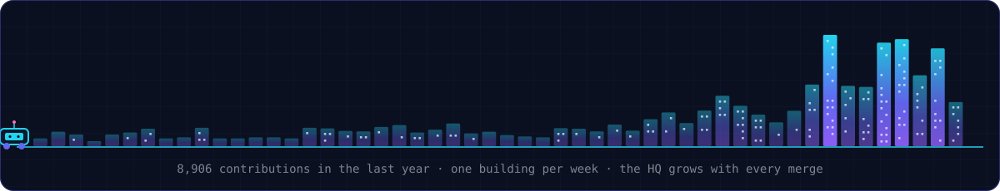

<!-- Header: assets/hq-header.svg, built by scripts/header.py -->

  

  
  
  
  

<!-- About: text-free hero next to the story -->
<table>
  <tr>
    <td width="52%" valign="middle">
      
       
      My career as a game: five floors, one rover, an AI concierge. The Classic site is one click away.
    </td>
    <td width="48%" valign="middle">

**Now** · leading Azure-native AI delivery at **Metrodata (MII)** for **12+ enterprises**

**Built** · realtime voice agents, cited RAG, fraud document AI, AI code security

**Before** · backends for e-commerce, travel and digital banking since 2019 (MNC, Jatis, Jenius)

**Rule** · an LLM feature isn't done until it's evaluated, guarded and observable

`800+` merged PRs in 2026 · `20` competition placings, `7` wins

</td>
  </tr>
</table>

##  &nbsp;Featured builds

| | Build | Result | |
|---|---|---|---|
| 🎙️ | **Realtime Voice AI Contact Center** Natural interruption, grounded answers, mid-call handoff to a human | caller interruption **~2 s → ~0.2 s** | [Case study →](https://kurniadi.pages.dev/en/labs/voice-ai-contact-center) |
| 🛡️ | **AI Code Security Platform** 8 scanners per PR across 100+ repos, AI triage and a fix agent | engines per PR **8** | [Case study →](https://kurniadi.pages.dev/en/labs/ai-code-security-platform) |
| 🔎 | **AI Fraud Document Review** OCR plus two-pass LLM review with evaluation gates | false positives **90.9% → 36.4%** | [Case study →](https://kurniadi.pages.dev/en/labs/fraud-review-platform) |
| 📦 | **Vendor Management Portal** POs, delivery acceptance, invoices, tax checks and approvals | solo, commit to deploy **6 weeks** | [Case study →](https://kurniadi.pages.dev/en/labs/vendor-management-portal) |

<a href="https://kurniadi.pages.dev/en/labs"><b>All projects in the Labs →</b></a>

##  &nbsp;Stack and certifications

  

  
  
  
  
  
  
  
  

  
  
  
  
  

<!-- Footer: assets/hq-skyline.svg, redrawn weekly by .github/workflows/skyline.yml -->

  

