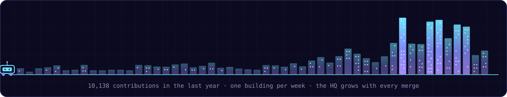

<!-- Built by scripts/: header.py (header), ui.py (keys and floor buttons), skyline.py (footer, weekly), refresh.py (facts and writing, daily) -->

  <a href="https://shinyq.my.id/en">
    <picture>
      <source media="(prefers-color-scheme: light)" srcset="assets/hq-header-light.svg" />
      
    </picture>
  </a>

  <a href="https://shinyq.my.id/en?view=3d"><picture><source media="(prefers-color-scheme: light)" srcset="assets/ui/key-enter-3d-light.svg" /></picture></a>
  <a href="https://shinyq.my.id/en/cv"><picture><source media="(prefers-color-scheme: light)" srcset="assets/ui/key-cv-light.svg" /></picture></a>
  <a href="https://www.linkedin.com/in/kurniadiwijaya"><picture><source media="(prefers-color-scheme: light)" srcset="assets/ui/key-linkedin-light.svg" /></picture></a>
  <a href="mailto:kurniadiahmadwijaya@gmail.com"><picture><source media="(prefers-color-scheme: light)" srcset="assets/ui/key-email-light.svg" /></picture></a>

  <a href="https://shinyq.my.id/en?view=classic"><picture><source media="(prefers-color-scheme: light)" srcset="assets/ui/floor-l1-light.svg" /></picture></a>
  <a href="https://shinyq.my.id/en/journey?view=classic"><picture><source media="(prefers-color-scheme: light)" srcset="assets/ui/floor-l2-light.svg" /></picture></a>
  <a href="https://shinyq.my.id/en/labs?view=classic"><picture><source media="(prefers-color-scheme: light)" srcset="assets/ui/floor-l3-light.svg" /></picture></a>
  <a href="https://shinyq.my.id/en/library?view=classic"><picture><source media="(prefers-color-scheme: light)" srcset="assets/ui/floor-l4-light.svg" /></picture></a>
  <a href="https://shinyq.my.id/en/contact?view=classic"><picture><source media="(prefers-color-scheme: light)" srcset="assets/ui/floor-rf-light.svg" /></picture></a>
  <a href="https://shinyq.my.id/en/build?view=classic"><picture><source media="(prefers-color-scheme: light)" srcset="assets/ui/floor-b1-light.svg" /></picture></a>

<table>
  <tr>
    <td width="50%" valign="middle">
      
       
      My career as a game: five floors, a rover and Ask, the AI concierge. Every floor has a Classic page too.
    </td>
    <td width="50%" valign="middle">

**Now** · Technical Consultant, Software & AI at **Metrodata (MII)**, leading Azure-native AI delivery

**Also** · AI Benchmark Engineer and Native Language Specialist (Indonesian) at **LILT**

**Built** · realtime voice agents, cited RAG, fraud document AI, AI code security

**Before** · backends for e-commerce, travel and digital banking since 2019 (MNC, Jatis, Jenius)

**Rule** · an LLM feature isn't done until it's evaluated, guarded and observable

<!-- facts:start -->
`1,190+` PRs merged in 2026&nbsp;· `12+` enterprise clients&nbsp;· `20` competition placings
<!-- facts:end -->

</td>
  </tr>
</table>

##  &nbsp;Featured builds

| Build | Result |
|---|---|
| 🎙️ **[Realtime Voice AI Contact Center](https://shinyq.my.id/en/labs/voice-ai-contact-center?view=classic)** ARIA: interruptible realtime voice, grounded answers, human handover | **~2 s → ~0.2 s** interruption controlled A/B, n=4 calls per arm |
| 🛡️ **[AI Code Security Platform](https://shinyq.my.id/en/labs/ai-code-security-platform?view=classic)** Pris.AI: 8 scanners per PR in a 100+ repo org, AI triage, a fix agent | **628** PRs reviewed with its scans 24 repos, by Oct 2026; fix PRs need human review |
| 🔎 **[AI Fraud Document Review](https://shinyq.my.id/en/labs/fraud-review-platform?view=classic)** MII Fraud Detection: OCR plus two-pass LLM review, evaluation gates | **90.9% → 36.4%** false positives offline development set; hybrid engine in shadow mode only |
| 📦 **[Vendor Management Portal](https://shinyq.my.id/en/labs/vendor-management-portal?view=classic)** eVendor: POs, delivery acceptance, invoices, tax checks, approvals | **6 weeks** first commit to deploy as the sole engineer |

<!-- writing:start -->

<b>Latest writing</b> &nbsp;·&nbsp; <a href="https://shinyq.my.id/en/blog/before-it-looked-like-talent?view=classic">Before It Looked Like Talent</a> &nbsp;·&nbsp; <a href="https://shinyq.my.id/en/blog/ten-very-hard-benchmark-tasks-in-ten-days?view=classic">Ten Very Hard Benchmark Tasks in Ten Days</a> &nbsp;·&nbsp; <a href="https://shinyq.my.id/en/library?view=classic">All writing →</a>

<!-- writing:end -->

##  &nbsp;Stack and certifications

  

  
  
  
  
  
  
  
  

  
  
  
  
  
  

  <picture>
    <source media="(prefers-color-scheme: light)" srcset="assets/hq-skyline-light.svg" />
    
  </picture>

